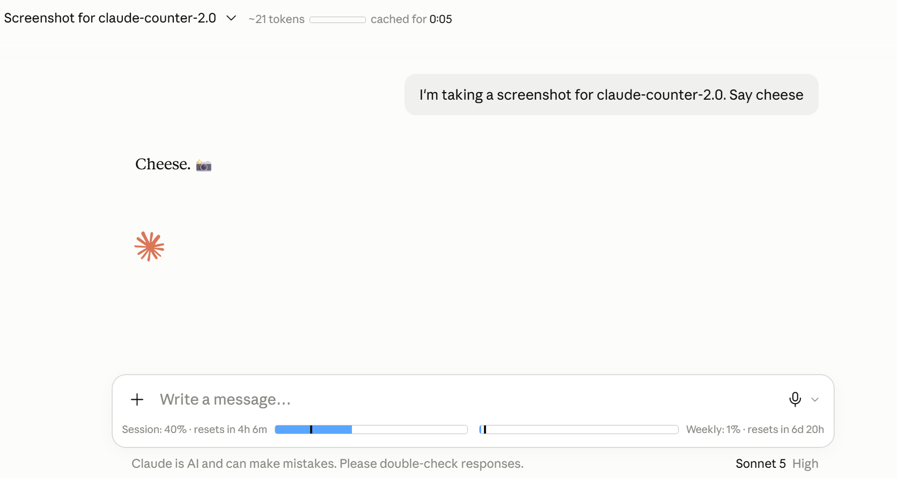

# Claude Counter

A minimal browser extension that shows token count, cache timer, and usage bars on claude.ai.

> Fork of [she-llac/claude-counter](https://github.com/she-llac/claude-counter) v0.4.2, updated for the claude.ai UI redesign (August 2026, 2.0.x) and for the new unified claude.ai interface (October 2026, 2.1.0).

## Features

- **Token count** — Approximate token count for the current conversation, with a mini progress bar against the 200k context limit
- **Cache timer** — Countdown showing how long the conversation remains cached (cheaper to continue)
- **Usage bars** — Session (5-hour) and weekly (7-day) usage from Claude's native API, with progress bars and reset countdowns

## Supported claude.ai interfaces

claude.ai is moving accounts to a new unified interface, and an account can be switched from one to the other.

| | Old interface | New interface |
| --- | --- | --- |
| Usage bars | `message_limit` in the `/completion` stream | limits in the `StreamTimeline` Connect stream |
| Token count, cache timer | conversation read when the page loads it | conversation read by the extension, again after every reply |

Both methods run side by side; whichever the page uses is picked up.

## What's changed from upstream v0.4.2

- Fixed broken selectors after claude.ai's UI redesign (`chat-title-split`, `bg-surface-3`)
- Usage bars now render inside the rounded composer box
- Bars persist across page refreshes via `chrome.storage.local`
- Bars always visible with 0% fallback (free plan returns nulls until first message)
- Org-scoped usage snapshot with expired-window cleanup
- Version bumped to 2.0.2 with resilient DOM anchoring, direct fetch fallbacks, and CSP compatibility
- 2.1.0, support for the new unified interface (details in the [changelog](CHANGELOG.md)):
  - The usage limits and the token count / cache timer are read from the new interface's `StreamTimeline` stream; the bars move while a reply is still being generated
  - **Usage bars persist across page reloads, tab changes and extension updates**: the saved snapshot is matched against every organisation id the page uses and restored again when the id becomes known later
  - **0% and "no data yet" are told apart**: a window the server reports without a number is 0% (the server leaves a zero out), a window that was never reported says "no data yet"
  - **A window that ended resets**: it shows 0% without the old value and a "resets in 0s" countdown, and fresh data is asked for at once
  - **The token count and cache timer sit on a second line under the start of the chat title**, inside the title bar (the bar keeps its height), instead of squeezing the title or covering the chat; if the title is not found they stay above the usage bars
  - `/usage` is no longer asked every second on plans where it reports nothing (free plan); failed requests back off up to an hour
  - A limits event that the server sends again after the stream was re-opened is not counted as a new reply (it would restart the cache timer without any work)
  - A chat whose parent links form a loop no longer hangs the token count
  - Tests: `npm test` (Node 22, no dependencies)

## Installation

**Chrome / Edge / Chromium 111 or newer**

1. Download the zip of the latest version from [Releases](../../releases) and unzip it
2. Go to `chrome://extensions` and enable **Developer mode**
3. Click **Load unpacked** and choose the unzipped folder (the one with `manifest.json`)

To update, unzip the new version over the old folder and click the reload button of the extension on `chrome://extensions`. Firefox has not been tried with 2.1.0.

## How it works

- Intercepts Claude's API responses to read conversation data and usage info
- Uses a vendored tokenizer (`o200k_base`) for approximate token counting
- Uses Claude's `/usage` plus the live limits that come with every reply (the old `message_limit` event, or the limits of the new `StreamTimeline` stream) for accurate progress bars
- Where `/usage` reports nothing (free plan) the bars show "no data yet" until the first reply of a session brings the limits; an ended window shows 0%
- Watches for DOM changes to inject UI elements as you navigate

## Debug tools (this branch, for developers)

This branch adds two tools used to develop against changes of the claude.ai interface. They are not part of the published extension; a developer who needs them can build this branch (**Load unpacked**) or copy the sources into their own.

- **Traffic recording** (off by default): open the extension's settings (`chrome://extensions` → Claude Counter → Details → Extension options) to record what claude.ai and its server exchange. Message text and binary values are masked unless you switch masking off, and conversation ids in addresses are always replaced. A recording is kept in the browser (about 2.5 MB per page load, the newest three) until you download or delete it; deleting it stops open tabs from recording until they are reloaded. Masking is a best-effort heuristic: look at a file before you share it. The recording also stores where the chat title sits in the page and how the message box and the buttons around it are laid out.
- **Diagnostics**: the same settings page lists what usage the extension saved (ids cut to eight characters, no message text) and a short log of saving and restoring. Use it when the usage bars say "no data yet" after a reload.

## Development

Load the repository folder with **Load unpacked** (Developer mode). Run the tests with `npm test` (Node 22, nothing to install).

## Privacy

- All data stays local — no external servers, no tracking
- Reads your `lastActiveOrg` cookie (or the organisation id the page itself uses) to query Claude's `/usage` endpoint
- Traffic recording is off unless you switch it on in the settings, and its data never leaves your browser unless you download it
- Makes requests only to `claude.ai`

## Credits

- Original project by [she-llac](https://github.com/she-llac/claude-counter) (MIT)
- Token counting via [gpt-tokenizer](https://github.com/niieani/gpt-tokenizer) (MIT)
- Inspired by [Claude Usage Tracker](https://github.com/lugia19/Claude-Usage-Extension) by lugia19

## License

MIT — see [LICENSE](LICENSE)
